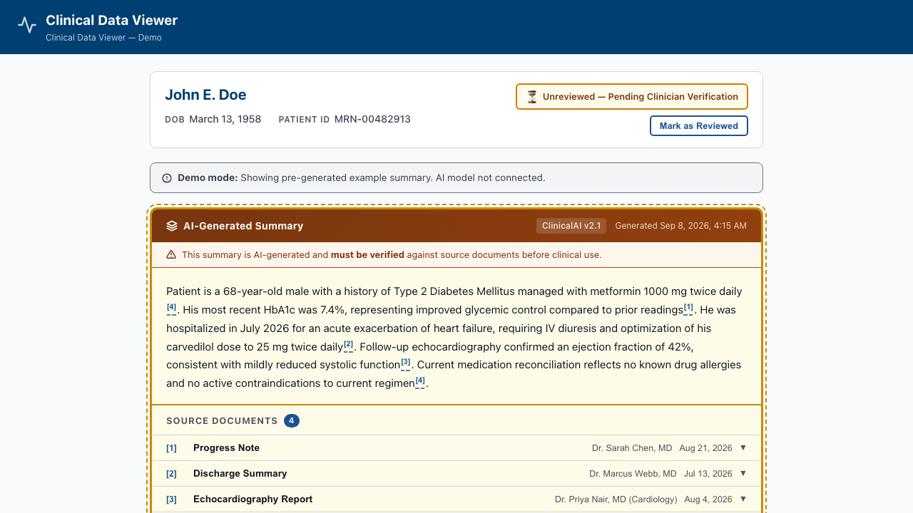

# Traceable Clinical Summary — UI Pattern Demo

A portfolio demonstration of a UI pattern for presenting AI-generated clinical summaries in a way that is traceable, clinician-verifiable, and accessible to assistive-technology users. Every factual claim in the summary is linked inline to the source document that supports it. All patient, clinician, and facility data is entirely fictional and is provided for visual demonstration only. This is not a clinical tool and must not be used for any medical purpose.

**Live demo:** [cashwellcamc.github.io/traceable-clinical-summary](https://cashwellcamc.github.io/traceable-clinical-summary/)



---

## Patterns demonstrated

**Inline citations to source documents**
Each factual claim in the AI summary carries a superscript citation `[n]` that is a real button. Clicking or activating it expands the matching source document and scrolls it into view. Every citation resolves to exactly one source; sources with no citation are flagged by the integrity test.

**AI labeling that survives screen readers**
The summary card is a `<section>` with a visible heading that reads "AI-Generated Summary", so the label is announced when a user enters the region. A warning banner reinforces that the content must be verified. The AI region is visually distinct (amber border, dashed outline, brown header) and also uses `forced-colors` overrides for high-contrast mode.

**Review state**
A clinician can mark the summary as reviewed. The state change is announced immediately through a `role="status"` live region so screen reader users are informed without losing focus. The badge shows reviewer name, role, and timestamp when reviewed.

**Citation integrity**
A Vitest test asserts at build time that every `sourceId` in the summary references an existing source document, and that every source is cited at least once. The deploy fails if this test fails.

---

## Stack

| Layer | Technology |
|---|---|
| UI | React 19, TypeScript |
| Build | Vite 8 |
| AI (optional, local only) | Google Generative AI SDK (`gemini-3.6-flash`) |
| Unit tests | Vitest |
| Accessibility + E2E tests | Playwright + `@axe-core/playwright` |
| Deploy | GitHub Actions → GitHub Pages |

---

## Running locally

```bash
npm install
npm run dev          # frontend at http://localhost:5173/traceable-clinical-summary/
```

The deployed build uses pre-generated mock data. To run with a live Gemini model, add your key to `.env`:

```
VITE_GEMINI_API_KEY=your-key-here
```

The app shows a "Demo mode" banner when no key is present and falls back to mock data silently on API errors.

```bash
# Optional: run the Express backend (local dev only, not used in production build)
npm run dev:server   # API server at http://localhost:3001
```

---

## Tests

```bash
npm test             # Vitest — citation integrity (2 tests)
npm run test:e2e     # Playwright — axe accessibility + keyboard (7 tests)
```

Both suites run in CI and the deploy fails if any test fails.

---

## Build

```bash
npm run build        # output to dist/
```

No `VITE_GEMINI_API_KEY` is set in the production build or CI workflow. The deployed demo always uses mock data.

---

## Accessibility verification

**Automated (Playwright + axe-core):**
- Zero axe violations at page load, with all sources expanded, and in the reviewed state
- Keyboard: skip link, citation buttons, source accordions (Enter/Space), and the Mark as Reviewed flow are all tested
- Reduced-motion: all CSS animations and transitions respect `prefers-reduced-motion: reduce`
- Reflow: layout tested at 320 px / 400% zoom with no horizontal scroll

**Pending manual screen reader check:**
The following should be verified with NVDA + Firefox and VoiceOver + Safari before production use:
- Live region announcement of the review state change
- Citation button accessible names read as "Source 1: Progress Note" (not just the superscript)
- Source accordion `aria-expanded` state announced on toggle
- AI summary heading announced when entering the section

The author holds a DHS Trusted Tester certification (v5).

---

## Restricting the API key (manual steps)

If you add `VITE_GEMINI_API_KEY` to a production build, the key will be visible in the JavaScript bundle. To limit blast radius, restrict it in Google Cloud Console:

1. Go to **console.cloud.google.com → APIs & Services → Credentials**
2. Click your key → **Application restrictions** → **HTTP referrers (websites)**
3. Add: `cashwellcamc.github.io/traceable-clinical-summary/*`
4. Under **API restrictions** → **Restrict key** → select **Generative Language API** only
5. Save

This means the key is rejected from any domain other than your Pages URL.

---

## What changes with a live model

| Concern | Notes |
|---|---|
| RAG / retrieval | In production, source documents are retrieved from a record store at query time rather than being hardcoded |
| Structured citation output | The model is prompted to return JSON with `sourceId` fields; those IDs must be validated against the retrieved document set before display |
| Loading / error states | The demo has basic states; production needs retry logic, partial-load states, and timeout handling |
| Caching and cost | Summaries should be cached per patient-encounter; re-generating on every page load is expensive |
| Citation validation | The app should reject any `sourceId` not in the current source set rather than silently omitting the citation |
